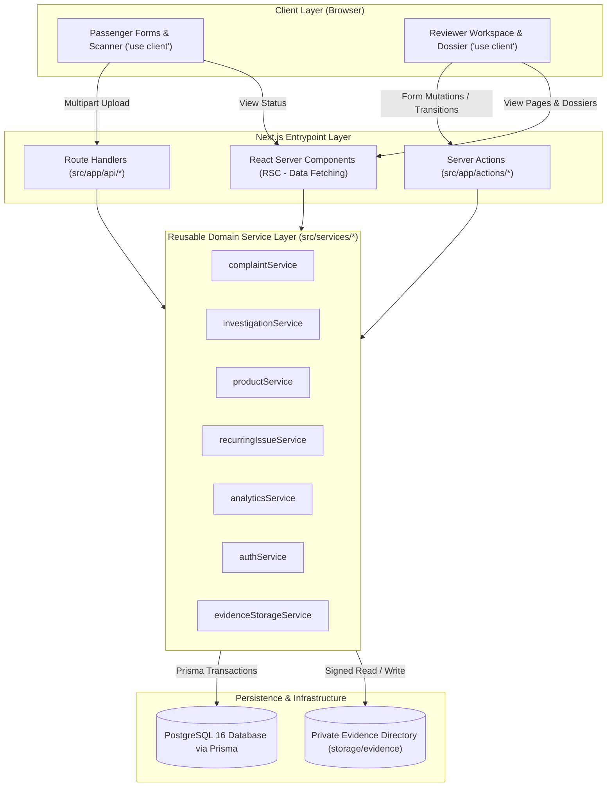

# RailGuard — Architecture Specification

---

## 1. System Overview

RailGuard is a full-stack railway food quality audit and passenger feedback platform built on **Next.js 16 (App Router)**, **TypeScript strict mode**, and **Prisma ORM** powered by **PostgreSQL 16**.

The system addresses two primary stakeholders:
1. **Passengers (Mobile-first public interface)**: Scan QR codes on registered food packaging, view accurate batch status, submit structured hygiene/spoilage complaints with photographs anonymously without account creation, and track resolution timelines securely via dual-key validation.
2. **Quality Reviewers & Administrators (Desktop operational control room)**: Monitor incoming allegations, examine photographic evidence via secure proxy streams, assign investigations, record official findings, track corrective actions, and analyze automated recurring-issue alerts.

---

## 2. Server vs. Client Boundary & Architecture Layers

To ensure security invariants, zero credential leakage, and eliminate code duplication, RailGuard establishes strict architectural boundaries:



### Responsibility Breakdown:

| Layer | Files | Responsibilities |
|---|---|---|
| **Server Components (RSC)** | `src/app/**/page.tsx`, `layout.tsx` | Secure server-side data loading, session extraction, initial rendering, zero bundle bloat. |
| **Server Actions** | `src/app/actions/*` | Form mutations originating directly from UI components (status transitions, investigator assignments, findings, corrective actions, demo resets, login/logout). |
| **Route Handlers** | `src/app/api/*` | Multipart form-data handling (`POST /api/complaints`), streaming private evidence images (`GET /api/evidence/[id]`), and public JSON endpoints (`GET /api/products/[id]`). |
| **Domain Services** | `src/services/*` | **Single Source of Truth for Business Rules**: Token hashing, state machine guards, atomic transaction bundling, metric computations, pattern detection. Never duplicated between Route Handlers and Server Actions. |
| **Client Components** | `src/components/*` (`"use client"`) | UI state, camera previews, dropdown filters, interactive modals, tabs. Contain NO database queries or privileged checks. |

---

## 3. Security & Data Integrity Invariants

### 3.1 Tracking Token Cryptographic Hashing
- When a complaint is submitted, the server generates a high-entropy 32-character random token (`crypto.randomBytes(24).toString("base64url")`).
- The server immediately hashes this token using SHA-256 (`crypto.createHash("sha256").update(token).digest("hex")`).
- Only `trackingTokenHash` is stored in the database.
- The raw unhashed token is returned to the passenger **only once** on the submission confirmation card and in the shareable URL.
- On `/track`, the passenger-submitted token is hashed with SHA-256 and matched against `trackingTokenHash`.
- Raw tokens are never stored in database tables, never listed in reviewer queues, and never exposed in API payloads.

### 3.2 Train Relationship & Fallback Architecture
- `Complaint.trainId` links directly to a registered `Train` record (`trainNumber`, `trainName`, origin, destination).
- When a passenger submits a train number, the service matches it against registered trains.
- If matched, `trainId` is populated and `unmatchedTrainNumber` is null.
- If not matched, `unmatchedTrainNumber` stores the raw input and `trainId` is null.
- UI and analytics resolve: `trainName = complaint.train?.trainName ?? "Unmatched Schedule (" + complaint.unmatchedTrainNumber + ")"`. This avoids duplicate desynchronized train numbers.

### 3.3 Dynamic Overdue Calculation (No Stale Flags)
- `CorrectiveActionStatus` stores only active stages: `PENDING`, `IN_PROGRESS`, `VERIFIED_COMPLETE`.
- An action is overdue if and only if `status !== 'VERIFIED_COMPLETE' && deadline < now()`.
- Dashboard calculations derive overdue counts dynamically, ensuring 100% synchronization with real time.

### 3.4 Atomic Audit Trail & Application Immutability
- Every status transition, investigator assignment, finding record, and corrective action write is executed within an atomic `prisma.$transaction(...)` alongside the creation of the corresponding `ComplaintEvent`.
- `ComplaintEvent` records cannot be updated or deleted via application APIs.
- Reopening a resolved or rejected case back to `UNDER_REVIEW` requires authorized reviewer/admin credentials and appends an immutable event log with justification.

### 3.5 Anonymous Passenger Identity & Role Separation
- Passengers submit complaints anonymously without account creation.
- `UserRole` enums are strictly restricted to internal personnel: `QUALITY_REVIEWER` and `ADMIN`.
- Passenger contact email and phone are purely optional notification channels stored on the complaint record, completely isolated from user accounts.
- Reviewers and administrators use authenticated sessions with secure, HTTP-only cookies.

---

## 4. Local Deployment & PostgreSQL Infrastructure

RailGuard standardizes on **PostgreSQL 16**.
To provide a zero-configuration local demonstration setup without paid cloud services or fragile dual-provider abstractions, the repository includes a standardized `docker-compose.yml`:

```yaml
version: '3.8'
services:
  postgres:
    image: postgres:16-alpine
    container_name: railguard-db
    environment:
      POSTGRES_USER: railguard
      POSTGRES_PASSWORD: railguard_secure_password
      POSTGRES_DB: railguard
    ports:
      - "5432:5432"
    volumes:
      - railguard_pgdata:/var/lib/postgresql/data
    healthcheck:
      test: ["CMD-SHELL", "pg_isready -U railguard -d railguard"]
      interval: 5s
      timeout: 5s
      retries: 5

volumes:
  railguard_pgdata:
```

Starting the database requires a single standard command:
```bash
docker compose up -d
```
All Prisma migrations (`npx prisma migrate dev`) and seed scripts (`npm run db:seed`) execute directly against this container. Remote managed PostgreSQL (e.g. Supabase) is supported simply by pointing `DATABASE_URL` in `.env.local`.

---

## 5. Private Evidence Storage Architecture

- **Local Private Storage Adapter**: By default, uploaded evidence images are stored in a non-public server directory (`storage/evidence/`).
- **Authenticated Streaming Proxy (`/api/evidence/[id]`)**: Images are streamed to the client only after validating:
  - An active Quality Reviewer or Administrator session cookie, OR
  - A time-limited (15-minute) cryptographic signed token generated by the server.
- **MIME & Size Enforcement**: Only `image/jpeg`, `image/png`, and `image/webp` up to 5MB (max 3 images) are accepted. Magic bytes are validated server-side.
- **Pluggable Cloud Option**: Supabase / S3 private storage can be activated via environment variables without altering domain logic.
