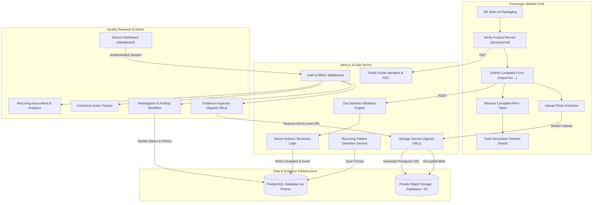

# RailGuard — Architecture Specification

---

## 1. System Overview

RailGuard is a full-stack railway food quality audit and passenger feedback platform built on **Next.js 16 (App Router)**, **TypeScript**, **PostgreSQL**, and **Prisma ORM**.

The system addresses two primary stakeholders:
1. **Passengers (Mobile-first public interface)**: Scan QR codes on authorized food packaging, verify product records, submit structured hygiene/spoilage complaints with photographs, and track resolution timelines securely.
2. **Quality Reviewers & Administrators (Desktop operational dashboard)**: Monitor incoming allegations, examine photographic evidence, assign investigations, record official findings, track corrective actions, and analyze automated recurring-issue alerts.

---

## 2. Architecture Diagram

---

## 3. Server vs. Client Boundary

To optimize performance and eliminate client-side credential exposure:

| Component Type | Primary Location | Responsibility |
|---|---|---|
| **Server Components (RSC)** | `src/app/**/page.tsx`, `src/app/**/layout.tsx` | Data fetching, database access, session resolution, initial HTML rendering, zero bundle bloat |
| **Client Components (`"use client"`)** | `src/components/passenger/*`, `src/components/dashboard/*`, `src/components/ui/*` | Form interactivity, camera/file upload previews, interactive search/filtering, modal dialogs, charts |
| **Server Actions / Route Handlers** | `src/app/api/*`, `src/services/*` | Zod validation, authenticated database transactions, private storage communication |

---

## 4. Distinction Between Allegation and Finding

A foundational architectural requirement is the strict separation between:
1. **Allegation (Passenger Complaint)**: Unverified passenger report regarding food quality, packaging condition, or foreign objects.
2. **Investigation**: Formal inquiry initiated by an authorized quality reviewer, recording timestamps, assigned personnel, and reviewer observations.
3. **Confirmed Finding**: Official substantiated determination (e.g., "Vendor Packaging Defect", "Temperature Non-Compliance", "Unsubstantiated / Inconclusive").
4. **Corrective Action**: Contractual or operational remedy imposed on the vendor (e.g., penalty, batch recall, process audit).

---

## 5. Evidence Isolation Architecture

Photographic evidence presents privacy, tampering, and bandwidth concerns:
- **Never public**: Images are stored in a private object storage bucket (e.g. Supabase Storage / S3).
- **Authorized access only**: Images are only retrievable through short-lived (e.g., 15-minute) presigned URLs generated server-side for authenticated reviewers.
- **File Validation**: Image uploads undergo MIME-type inspection, extension validation, and maximum size limits (5MB per image, max 3 images).

---

## 6. Audit Trail & Immutability

Every complaint status change automatically appends a row to the `ComplaintEvent` table:
- Previous status and new status
- Actor user ID (or System)
- Timestamp
- Reason / explanation
- `isPublic` flag (distinguishing passenger-visible timeline updates from internal investigation notes)

Complaint events are append-only. No deletion or editing of event history is permitted.
