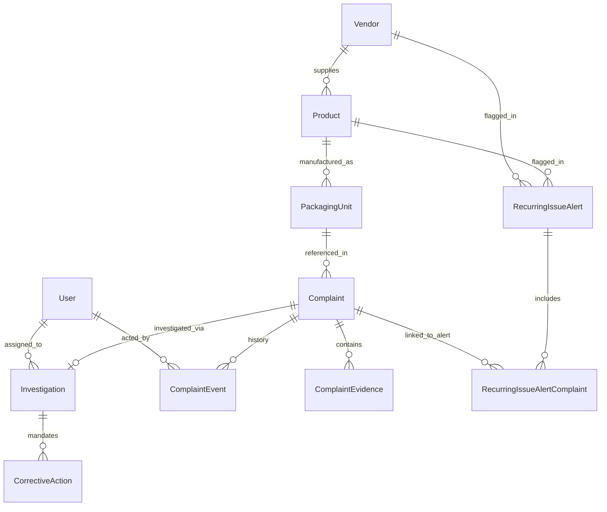
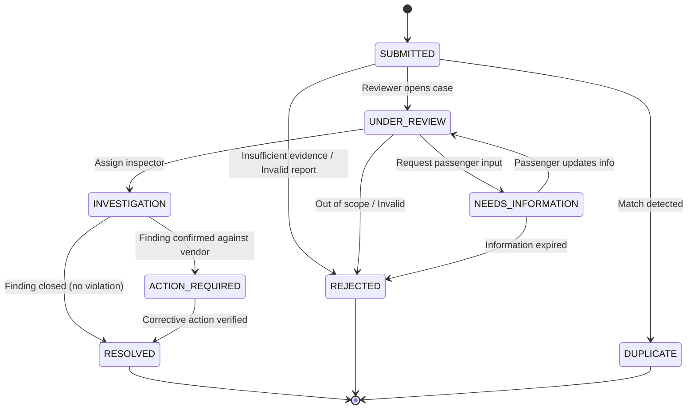

# RailGuard — Database Specification

---

## 1. Overview

RailGuard uses **PostgreSQL** managed through **Prisma ORM**. The data model enforces referential integrity, status progression constraints, append-only audit histories, and efficient indexing for analytical and operational queries.

---

## 2. Entity-Relationship Model

---

## 3. Detailed Entity Definitions

### 3.1 `User`
Authorized personnel accessing the dashboard.
- `id`: UUID (Primary Key)
- `email`: String (Unique)
- `name`: String
- `passwordHash`: String
- `role`: Enum (`PASSENGER`, `QUALITY_REVIEWER`, `ADMIN`)
- `createdAt`: DateTime
- `updatedAt`: DateTime

### 3.2 `Vendor`
Catering companies, base kitchen operators, or pantry contractors.
- `id`: UUID (Primary Key)
- `name`: String
- `code`: String (Unique, e.g., `VND-NR-001`)
- `contactEmail`: String
- `contactPhone`: String?
- `licenseNumber`: String (FSSAI or IRCTC authorization number)
- `status`: Enum (`ACTIVE`, `SUSPENDED`, `UNDER_REVIEW`)
- `createdAt`: DateTime

### 3.3 `Product`
Approved menu items or packaged goods.
- `id`: UUID (Primary Key)
- `vendorId`: UUID (Foreign Key -> Vendor.id)
- `name`: String (e.g., "Standard Veg Thali", "Rail Neer 1L")
- `category`: Enum (`MEAL_TRAY`, `PACKAGED_WATER`, `SNACK_BOX`, `BEVERAGE`, `SPECIAL_DIET`)
- `fssaiLicense`: String
- `standardPrice`: Decimal?
- `shelfLifeHours`: Int
- `createdAt`: DateTime

### 3.4 `PackagingUnit`
Individual manufactured batch or trackable item instance.
- `id`: UUID (Primary Key)
- `productId`: UUID (Foreign Key -> Product.id)
- `batchNumber`: String
- `packagingDate`: DateTime
- `expiryDate`: DateTime
- `qrCodeIdentifier`: String (Unique UUID or cryptographically signed token)
- `status`: Enum (`ACTIVE`, `EXPIRED`, `RECALLED`)
- `createdAt`: DateTime

### 3.5 `Complaint`
The passenger's reported issue.
- `id`: UUID (Primary Key)
- `complaintRef`: String (Unique, user-friendly format e.g. `RG-2026-10482`)
- `trackingToken`: String (Secure verification hash to prevent enumeration attacks)
- `packagingUnitId`: UUID? (Foreign Key -> PackagingUnit.id, nullable if unverified)
- `category`: Enum (`SPOILAGE`, `FOREIGN_OBJECT`, `HYGIENE_PACKAGING`, `TEMPERATURE`, `PRODUCT_MISMATCH`, `OTHER`)
- `severity`: Enum (`LOW`, `MEDIUM`, `HIGH`, `CRITICAL`)
- `description`: Text (Max 2,000 chars)
- `trainNumber`: String? (e.g., `12951`)
- `journeyDate`: DateTime?
- `coach`: String? (e.g., `B3-42`)
- `contactEmail`: String?
- `contactPhone`: String?
- `status`: Enum (`SUBMITTED`, `UNDER_REVIEW`, `INVESTIGATION`, `ACTION_REQUIRED`, `NEEDS_INFORMATION`, `RESOLVED`, `REJECTED`, `DUPLICATE`)
- `createdAt`: DateTime
- `updatedAt`: DateTime

### 3.6 `ComplaintEvidence`
Photographic evidence attached to a complaint.
- `id`: UUID (Primary Key)
- `complaintId`: UUID (Foreign Key -> Complaint.id)
- `storagePath`: String (Internal path in private bucket, never a public URL)
- `fileName`: String
- `fileSizeBytes`: Int
- `mimeType`: String (`image/jpeg`, `image/png`, `image/webp`)
- `uploadedAt`: DateTime

### 3.7 `ComplaintEvent`
Immutable audit log of all status transitions and communications.
- `id`: UUID (Primary Key)
- `complaintId`: UUID (Foreign Key -> Complaint.id)
- `actorId`: UUID? (Foreign Key -> User.id, null if passenger or system)
- `actorRole`: String (`PASSENGER`, `QUALITY_REVIEWER`, `ADMIN`, `SYSTEM`)
- `previousStatus`: String?
- `newStatus`: String
- `explanation`: Text
- `isPublic`: Boolean (true: visible on passenger tracking page; false: internal reviewer note)
- `createdAt`: DateTime

### 3.8 `Investigation`
Official investigation launched for a complaint.
- `id`: UUID (Primary Key)
- `complaintId`: UUID (Unique, Foreign Key -> Complaint.id)
- `investigatorId`: UUID? (Foreign Key -> User.id)
- `findings`: Text?
- `determination`: Enum (`UNSUBSTANTIATED`, `VENDOR_FAULT`, `STORAGE_FAULT`, `INCONCLUSIVE`)?
- `isCompleted`: Boolean (Default: false)
- `assignedAt`: DateTime
- `completedAt`: DateTime?

### 3.9 `CorrectiveAction`
Operational remedy mandated as a result of investigation.
- `id`: UUID (Primary Key)
- `investigationId`: UUID (Foreign Key -> Investigation.id)
- `actionType`: Enum (`WARNING_LETTER`, `FINANCIAL_PENALTY`, `BATCH_RECALL`, `KITCHEN_AUDIT`, `STAFF_RETRAINING`)
- `description`: Text
- `deadline`: DateTime?
- `status`: Enum (`PENDING`, `IN_PROGRESS`, `VERIFIED_COMPLETE`, `OVERDUE`)
- `createdAt`: DateTime
- `verifiedAt`: DateTime?

### 3.10 `RecurringIssueAlert` & `RecurringIssueAlertComplaint`
Algorithmic detection of clustered complaints.
- `id`: UUID (Primary Key)
- `vendorId`: UUID? (Foreign Key -> Vendor.id)
- `productId`: UUID? (Foreign Key -> Product.id)
- `category`: Enum (ComplaintCategory)
- `triggerCount`: Int (e.g., 3 complaints)
- `timeWindowHours`: Int (e.g., 48 hours)
- `reason`: Text
- `status`: Enum (`OPEN`, `ACKNOWLEDGED`, `INVESTIGATED`, `DISMISSED`)
- `createdAt`: DateTime

---

## 4. Valid Status Transitions State Machine

