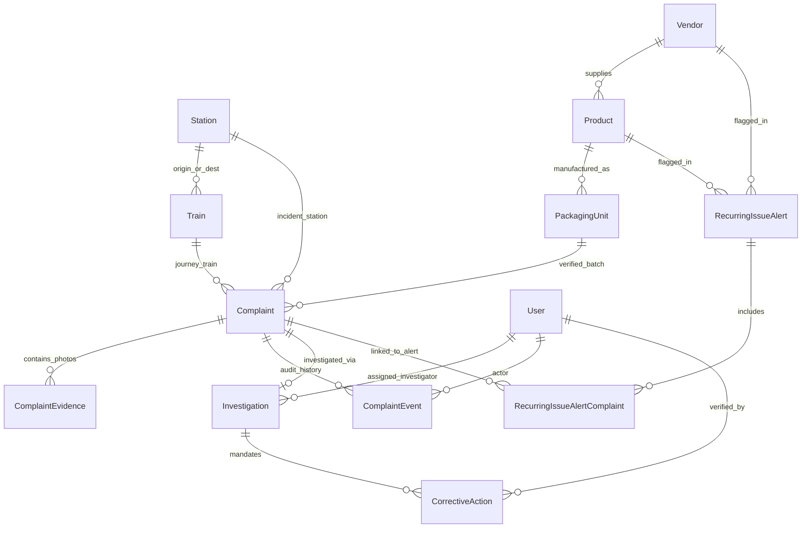
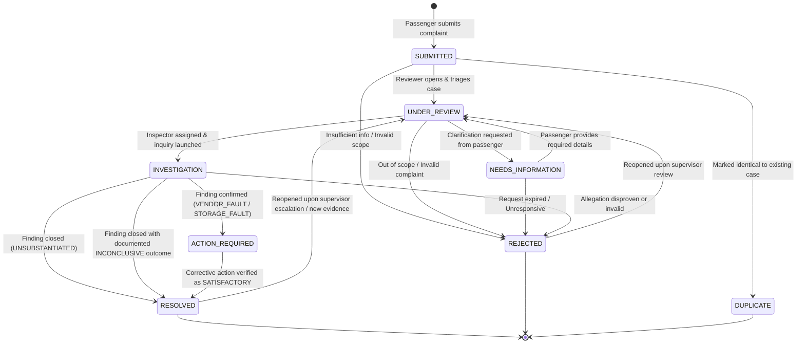

# RailGuard — Database Specification

---

## 1. Overview & Provider Strategy

RailGuard uses **PostgreSQL 16** as its single authoritative database engine, managed through **Prisma ORM**.
- **Production & Demonstration Standardization**: Standardizing on PostgreSQL guarantees full support for native PostgreSQL enums, strict relational foreign key constraints, microsecond timestamp precision, and atomic multi-table transactions.
- **Local Demonstration via Docker**: A production-grade `docker-compose.yml` provides an instant local PostgreSQL 16 container with healthchecks and persistent volumes (`railguard_pgdata`). Remote managed PostgreSQL (e.g. Supabase) is supported via standard connection strings in `.env.local`.
- **No Fragile Dual-Provider Abstraction**: SQLite is deliberately avoided for core data storage because it lacks native enum enforcement, has differing transaction semantics, and causes Prisma schema desynchronization.

---

## 2. Entity-Relationship Model

---

## 3. Detailed Entity Definitions & Constraints

### 3.1 `User`
Authorized railway personnel accessing the control room. Passengers do not have user accounts.
- `id`: UUID (Primary Key)
- `email`: String (Unique)
- `name`: String
- `passwordHash`: String
- `role`: Enum (`QUALITY_REVIEWER`, `ADMIN`)
- `createdAt`: DateTime (default `now()`)
- `updatedAt`: DateTime (`@updatedAt`)
- Relations: `investigations`, `complaintEvents`, `verifiedActions`, `deletedComplaints` (audited soft-deleted complaints)

### 3.2 `Station`
Indian Railways stations representing boarding points, transit stops, or base kitchen loading locations.
- `id`: UUID (Primary Key)
- `code`: String (Unique, Indexed, e.g. `NDLS`, `MMCT`, `HWH`, `MAS`, `SBC`, `CNB`, `BSL`, `PUNE`)
- `name`: String (e.g. "New Delhi", "Mumbai Central")
- `division`: String (e.g. "Delhi", "Mumbai")
- `zone`: String (e.g. "Northern Railway", "Western Railway")
- `createdAt`: DateTime (default `now()`)

### 3.3 `Train`
Scheduled passenger trains with routes and catering cars.
- `id`: UUID (Primary Key)
- `trainNumber`: String (Unique, Indexed, e.g. `12951`)
- `trainName`: String (e.g. "Mumbai Rajdhani Express")
- `originStationId`: UUID (Foreign Key -> Station.id, `onDelete: Restrict`)
- `destinationStationId`: UUID (Foreign Key -> Station.id, `onDelete: Restrict`)
- `createdAt`: DateTime (default `now()`)

### 3.4 `Vendor`
Catering companies, base kitchen operators, or pantry contractors.
- `id`: UUID (Primary Key)
- `name`: String
- `code`: String (Unique, Indexed, e.g. `VND-NR-001`)
- `contactEmail`: String
- `contactPhone`: String?
- `licenseNumber`: String (FSSAI or IRCTC authorization number)
- `status`: Enum (`ACTIVE`, `SUSPENDED`, `UNDER_REVIEW`)
- `createdAt`: DateTime (default `now()`)
- `updatedAt`: DateTime (`@updatedAt`)

### 3.5 `Product`
Approved menu items or packaged goods.
- `id`: UUID (Primary Key)
- `vendorId`: UUID (Foreign Key -> Vendor.id, `onDelete: Cascade`)
- `name`: String (e.g., "Standard Veg Thali", "Rail Neer 1L")
- `category`: Enum (`MEAL_TRAY`, `PACKAGED_WATER`, `SNACK_BOX`, `BEVERAGE`, `SPECIAL_DIET`)
- `fssaiLicense`: String
- `standardPrice`: Decimal? (`@db.Decimal(10, 2)`)
- `shelfLifeHours`: Int (default 24)
- `createdAt`: DateTime (default `now()`)
- `updatedAt`: DateTime (`@updatedAt`)

### 3.6 `PackagingUnit`
Individual manufactured batch or trackable item instance.
- `id`: UUID (Primary Key)
- `productId`: UUID (Foreign Key -> Product.id, `onDelete: Cascade`)
- `batchNumber`: String (Indexed)
- `packagingDate`: DateTime
- `expiryDate`: DateTime
- `qrCodeIdentifier`: String (Unique, Indexed, e.g. `DEMO-THALI-ACTIVE-001`)
- `status`: Enum (`ACTIVE`, `EXPIRED`, `RECALLED`)
- `createdAt`: DateTime (default `now()`)
- `updatedAt`: DateTime (`@updatedAt`)

### 3.7 `Complaint` (with Soft-Deletion & Token Security)
The passenger's reported quality or hygiene allegation.
- `id`: UUID (Primary Key)
- `complaintRef`: String (Unique, Indexed, e.g. `RG-2026-10482`)
- **`trackingTokenHash`**: String (Unique, Indexed, SHA-256 hash of the 32-character random tracking token. The raw token is NEVER stored in database rows).
- `packagingUnitId`: UUID? (Foreign Key -> PackagingUnit.id, `onDelete: SetNull`)
- `category`: Enum (`SPOILAGE`, `FOREIGN_OBJECT`, `HYGIENE_PACKAGING`, `TEMPERATURE`, `PRODUCT_MISMATCH`, `OTHER`)
- `severity`: Enum (`LOW`, `MEDIUM`, `HIGH`, `CRITICAL`, default `MEDIUM`)
- `description`: Text (Min 15, Max 2,000 chars)
- **`trainId`**: UUID? (Primary train relation, Foreign Key -> Train.id, `onDelete: SetNull`)
- **`unmatchedTrainNumber`**: String? (Fallback text field only populated if passenger's entered train is not found in the schedule)
- `stationId`: UUID? (Foreign Key -> Station.id, `onDelete: SetNull`, represents incident or loading station)
- `journeyDate`: DateTime?
- `coach`: String? (e.g., "B3")
- `seat`: String? (e.g., "42")
- `contactEmail`: String? (Optional notification channel, not a user account)
- `contactPhone`: String? (Optional notification channel)
- `status`: Enum (`SUBMITTED`, `UNDER_REVIEW`, `INVESTIGATION`, `ACTION_REQUIRED`, `NEEDS_INFORMATION`, `RESOLVED`, `REJECTED`, `DUPLICATE`)
- `rejectionReason`: String? (Mandatory if status is `REJECTED`)
- **`deletedAt`**: DateTime? (Soft-deletion timestamp. Complaints with investigations are never hard-deleted)
- **`deletedReason`**: String? (Documented reason for soft-deletion)
- **`deletedById`**: UUID? (Foreign Key -> User.id, `onDelete: SetNull`, audit trail of administrator authorizing soft deletion)
- `createdAt`: DateTime (default `now()`, Indexed)
- `updatedAt`: DateTime (`@updatedAt`)

### 3.8 `ComplaintEvidence`
Photographic evidence attached to a complaint.
- `id`: UUID (Primary Key)
- `complaintId`: UUID (Foreign Key -> Complaint.id, `onDelete: Cascade`)
- `storagePath`: String (Internal private file path outside web root, never a public URL)
- `fileName`: String
- `fileSizeBytes`: Int
- `mimeType`: String (`image/jpeg`, `image/png`, `image/webp`)
- `uploadedAt`: DateTime (default `now()`)

### 3.9 `ComplaintEvent`
Immutable audit log of all status transitions, findings, assignments, and corrective actions.
- `id`: UUID (Primary Key)
- `complaintId`: UUID (Foreign Key -> Complaint.id, `onDelete: Cascade`, Indexed)
- `actorId`: UUID? (Foreign Key -> User.id, `onDelete: SetNull`)
- `actorRole`: String (`QUALITY_REVIEWER`, `ADMIN`, `PASSENGER`, `SYSTEM`)
- `previousStatus`: String?
- `newStatus`: String
- `explanation`: Text (Mandatory explanation or justification)
- `isPublic`: Boolean (true: visible on passenger tracking; false: internal reviewer note)
- `createdAt`: DateTime (default `now()`, Indexed)

### 3.10 `Investigation`
Official inquiry launched for a complaint.
- `id`: UUID (Primary Key)
- `complaintId`: UUID (Unique, Foreign Key -> Complaint.id, **`onDelete: Restrict`** — complaints with active or historical investigations cannot be hard-deleted)
- `investigatorId`: UUID? (Foreign Key -> User.id, `onDelete: SetNull`)
- `findings`: Text? (Chronological field notes, lab test logs, vendor statements)
- `determination`: Enum (`UNSUBSTANTIATED`, `VENDOR_FAULT`, `STORAGE_FAULT`, `INCONCLUSIVE`)?
- `isCompleted`: Boolean (default `false`)
- `assignedAt`: DateTime (default `now()`)
- `completedAt`: DateTime?
- `updatedAt`: DateTime (`@updatedAt`)

### 3.11 `CorrectiveAction`
Operational remedy mandated as a result of investigation.
- `id`: UUID (Primary Key)
- `investigationId`: UUID (Foreign Key -> Investigation.id, `onDelete: Cascade`, Indexed)
- `actionType`: Enum (`WARNING_LETTER`, `FINANCIAL_PENALTY`, `BATCH_RECALL`, `KITCHEN_AUDIT`, `STAFF_RETRAINING`)
- `description`: Text (Formal contractual/remedial instruction)
- `responsibleParty`: String (Vendor contractor, base kitchen manager)
- `deadline`: DateTime? (Compliance due date)
- **`status`**: Enum (`PENDING`, `IN_PROGRESS`, `VERIFIED_COMPLETE`) — Note: `OVERDUE` is NOT a stored state; overdue status is derived dynamically when `deadline < now()` and `status !== VERIFIED_COMPLETE`.
- `completionEvidence`: Text? (Vendor response or proof document)
- `verificationOutcome`: Enum (`SATISFACTORY`, `NON_COMPLIANT`, `ESCALATED`)?
- `verifiedAt`: DateTime?
- `verifiedById`: UUID? (Foreign Key -> User.id, `onDelete: SetNull`)
- `createdAt`: DateTime (default `now()`)
- `updatedAt`: DateTime (`@updatedAt`)

### 3.12 `RecurringIssueAlert` & `RecurringIssueAlertComplaint`
Rule-based detection of clustered complaints.
- `id`: UUID (Primary Key)
- `vendorId`: UUID? (Foreign Key -> Vendor.id, `onDelete: SetNull`, Indexed)
- `productId`: UUID? (Foreign Key -> Product.id, `onDelete: SetNull`, Indexed)
- `stationId`: UUID? (Foreign Key -> Station.id, `onDelete: SetNull`, Indexed)
- `category`: Enum (ComplaintCategory)
- `triggerCount`: Int (default 3)
- `timeWindowHours`: Int (default 48)
- `reason`: Text
- `status`: Enum (`OPEN`, `ACKNOWLEDGED`, `INVESTIGATED`, `DISMISSED`)
- `createdAt`: DateTime (default `now()`)
- `updatedAt`: DateTime (`@updatedAt`)

---

## 4. Formal Complaint State Machine & Investigation Reopening

### 4.1 Investigation Reopening Rules:
- **Preservation of History**: When a case is reopened from `RESOLVED` or `REJECTED` to `UNDER_REVIEW`, the prior `Investigation` record and its findings are **strictly preserved** and never deleted or overwritten.
- **Investigation Lifecycle Reset**: `Investigation.isCompleted` is marked `false`, allowing supplementary inquiry notes to be appended.
- **Append-Only Chronological Notes**: Findings are updated with an append-only header:  
  `[Reopened YYYY-MM-DD HH:MM by <User>]: <Justification for reopening and new inquiry scope>`.
- **Existing Corrective Actions**: Any corrective actions already recorded remain intact in their historical state. If new actions are warranted, separate `CorrectiveAction` rows are created.
- **Audit Logging**: An immutable `ComplaintEvent` is appended recording `previousStatus: 'RESOLVED'`, `newStatus: 'UNDER_REVIEW'`, actor ID, and the formal justification.

---

## 5. Deletion, Retention & Safe Evidence Cleanup Policy

1. **Restricted Deletion**: Complaints linked to an `Investigation` carry `onDelete: Restrict`. They cannot be hard-deleted through normal administrative operations.
2. **Soft Deletion**: Complaints can only be soft-deleted by an `ADMIN` setting `deletedAt`, `deletedReason`, and `deletedById` (UUID referencing `User.id`). Soft-deleted complaints are excluded from public tracking, active queues, and analytics.
3. **Safe Post-Commit Cleanup Queue / Outbox**:
   - Filesystem deletion cannot be rolled back by a database transaction. Therefore, physical evidence files are never deleted synchronously prior to transaction commit.
   - When evidence files are marked for removal (e.g., during administrative demo resets or retention purging):
     a. The database transaction marks or deletes the records and records the file path in a post-commit cleanup outbox queue.
     b. Physical filesystem deletion is executed **only after the database transaction successfully commits**.
     c. If physical deletion encounters an I/O or permission error, the failure is logged and recorded in the cleanup retry queue. Database records never point to missing files without an auditable record of failure.
4. **Audit Retention**: `ComplaintEvent` audit rows are retained permanently. Active complaints are retained indefinitely for the demonstration.

---

## 6. Analytics Metric Definitions & Formulas

All dashboard calculations are computed strictly from database records:

| Metric Name | Exact Formula / Query Rule | Inclusions / Exclusions |
|---|---|---|
| **Total Active Cases** | `status IN ('SUBMITTED', 'UNDER_REVIEW', 'INVESTIGATION', 'NEEDS_INFORMATION', 'ACTION_REQUIRED') AND deletedAt IS NULL` | Excludes `RESOLVED`, `REJECTED`, `DUPLICATE`, and soft-deleted records. |
| **Urgent Spoilage Cases** | Active cases WHERE `category IN ('SPOILAGE', 'FOREIGN_OBJECT') AND severity IN ('HIGH', 'CRITICAL')` | Filters to open, high-risk safety hazards only. |
| **Overdue Investigations** | `status = 'INVESTIGATION' AND investigation.determination IS NULL AND (now() - investigation.assignedAt) > 48 hours` | Dynamically calculated using current time. |
| **Overdue Corrective Actions** | `status IN ('PENDING', 'IN_PROGRESS') AND deadline < now()` | Derived dynamically from current timestamp. |
| **Total Resolved** | `status = 'RESOLVED' AND deletedAt IS NULL` | Counts verified closed complaints. If reopened, case leaves this count. |
| **Duplicate Cases** | `status = 'DUPLICATE'` | Excluded from vendor penalty ratios and active queues. |
| **Rejected Cases** | `status = 'REJECTED'` | Excluded from vendor fault statistics; grouped by rejection reason. |
| **Vendor Compliance Rate (%)** | $$\frac{\text{Count of SATISFACTORY verified actions}}{D} \times 100$$ Where $D = \text{SATISFACTORY} + \text{NON\_COMPLIANT} + \text{ESCALATED} + \text{OVERDUE\_UNCOMPLETED}$. | **Each action is counted exactly once** into mutually exclusive buckets. Overdue is a derived condition (`status != 'VERIFIED_COMPLETE' AND deadline < now()`), not an additional action record. Actions in grace period (`deadline >= now()` and pending) are excluded from $D$. If $D = 0$, returns `null` ("No Actions Due"). |
| **Mean Resolution Time** | Average duration between `Complaint.createdAt` and final `RESOLVED` `ComplaintEvent.createdAt` | Calculated across all currently resolved cases. |
